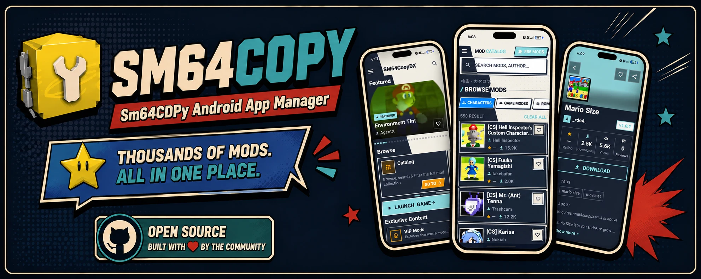

# SM64CDPY — Navegador de mods para SM64CoopDX

[English](README.md) · **Español** · [Português do Brasil](README_PT.md)

SM64CDPY es un navegador y gestor de mods no oficial, orientado a Android, para
**SM64CoopDX**. Reúne el descubrimiento, descarga e instalación de contenido,
la integración con el juego y la actualización del catálogo en una interfaz
móvil.

El proyecto está en mantenimiento activo. Su versión de desarrollo es **1.9.1+29**.
La burbuja flotante de la línea 1.7 está implementada, pero sigue siendo
experimental hasta completar pruebas en dispositivos Android reales.



## Para qué sirve y cuál es su potencial

La aplicación busca ser un compañero móvil completo para SM64CoopDX, no solo
una lista de mods. Puede unir el proceso de encontrar contenido, descargarlo y
colocarlo en una carpeta accesible para el juego, mostrando el progreso de
descarga e instalación.

- La guía **Cómo jugar**, en Recursos, explica paso a paso cómo instalar el juego Android, preparar tu ROM USA, conectar la carpeta y añadir el primer mod.
- Catálogo comunitario con búsqueda, categorías, filtros y favoritos.
- Gestor de descargas en segundo plano con progreso, cancelación y
  notificaciones.
- Instalador de ZIP, 7z y archivos sueltos mediante Storage Access Framework.
- La instalación rápida opcional usa escritura directa en carpetas compatibles del juego tras conceder el acceso en Ajustes; la instalación normal mediante SAF sigue disponible.
- Burbuja flotante accesible mientras el juego está abierto.
- Actualización de catálogos y de APK por arquitectura del dispositivo.
- Base para mejorar la instalación automática, recuperación tras cierres de
  Android y una experiencia más directa dentro del juego.

## Funciones actuales

- Catálogo principal, contenido popular y destacado.
- Prepara tu propia ROM USA de Super Mario 64 localmente: la herramienta detecta `.z64`, `.v64` y `.n64`, valida el volcado esperado y exporta una copia `.z64` verificada sin modificar el original. [Detalles del preparador](ROM_CONVERTER.md).
- Secciones VIP, DynOS, controles táctiles, OMM Rebirth y Render96.
- Importación y exportación de favoritos en JSON.
- Biblioteca local de contenido instalado, reciente, mods del juego y con
  actualizaciones disponibles.
- Interfaz en inglés, español, portugués brasileño, francés e italiano; diseños Minimal, Retro Manga, Manga Deluxe y Mario Kart 64, con apariencia clara, oscura o del teléfono. El panel flotante conserva su diseño oscuro fijo.
- Manga Deluxe remasteriza la interfaz de tinta y papel con imágenes de CoopDX, fondo móvil opcional, bienvenida compacta que puedes omitir, enlaces a vídeos oficiales bajo demanda y ayuda rápida. [Diseño y funcionamiento](docs/MANGA_DELUXE.md).
- Actualización manual de bases JSON remotas.
- Conecta una vez la carpeta user del juego con el selector de Android. Mods, DynOS/Touch Controls y detección de ROM reutilizan esa conexión.
- Resolución de enlaces, incluidos assets de GitHub Releases.
- Descarga e instalación mediante WorkManager con progreso y cancelación.
- Copia de archivos sueltos y extracción de ZIP/7z.
- Lanzamiento de SM64CoopDX y actualización OTA de la aplicación.
- Espacio de Jugador para editar nombre, personaje y paleta dentro del juego,
  administrar presets reutilizables y revisar los cambios en una vista 3D
  interactiva generada desde los recursos locales conectados por el usuario.
- Interfaz Minimalista de bajo costo disponible en Ajustes; Retro Manga vuelve
  a ser el diseño predeterminado y Mario 64/SM64 Intro siguen como opciones.

## Burbuja flotante

El overlay utiliza un segundo engine de Flutter sobre el juego. Permite buscar,
solicitar o cancelar descargas y recibir el progreso reenviado por el engine
principal. Como ambos engines no comparten memoria y Android puede recrear el
proceso, todavía requiere pruebas de concurrencia, permisos y recuperación en
Android 7–16.

## Estado actual

- Catálogo, descargas, instalación y actualización OTA: implementados.
- Overlay: implementado, en estabilización y pruebas.
- Plataforma soportada: Android 7.0 o superior (`minSdk 24`).
- Pruebas automatizadas: pruebas unitarias/widgets de Flutter, contrato Python
  de manifiestos y pruebas unitarias nativas de Android ejecutadas en CI.

Consulta [Estado y próximos pasos](docs/PROJECT_STATUS.md).

## Compilación rápida

Requiere Flutter **3.41.7**, Dart **3.11.x**, Java 17 y Android SDK.

```bash
flutter pub get
flutter analyze --no-fatal-infos
flutter build apk --release --target-platform android-arm64 --split-per-abi
```

La guía completa está en [BUILDING.md](BUILDING.md) y el índice técnico en
[docs/README.md](docs/README.md).

## Repositorios locales de referencia

Komi Store, Floating Apps y otros repositorios clonados son ejemplos locales
para investigación. Están excluidos mediante `.gitignore`, no forman parte de
la aplicación y no deben subirse a GitHub ni entrar en el análisis o build del
proyecto. Solo están representados en el
[archivo documental](docs/archive/README.md).

## Privacidad y aviso

La app no tiene cuentas, publicidad ni telemetría. Usa Internet para catálogos,
descargas, actualizaciones y recursos externos; favoritos y preferencias se
guardan localmente.

Es un proyecto personal no oficial, sin afiliación con SM64CoopDX, Nintendo o
los autores de mods. El contenido pertenece a sus respectivos creadores.

[Releases](https://github.com/retired64/sm64cdpy.releases/releases) ·
[Discord](https://discord.com/invite/thuhUH2WNX)

Biblioteca también permite configurar mods Lua locales compatibles para el próximo inicio del juego, seleccionando la carpeta principal del juego, con guardado verificado y respaldo privado. Cierra el juego antes de editar. Los packs DynOS y Touch Controls de dynos/packs y user/dynos/packs tienen sus propios interruptores en la misma Biblioteca, usando la configuración dynos-pack del juego.

La versión 1.8.4 mejoró la respuesta de Biblioteca. La versión 1.8.5 añade el
espacio de Jugador y la vista 3D interactiva; consulta la [preparación del lanzamiento](docs/RELEASE_1.8.5.md)
y la [arquitectura del renderizador](docs/PLAYER_3D_RENDERER.md).

Elige la carpeta principal `com.maniscat2.sm64coopdx` para incluir mods y packs DynOS dentro y fuera de `user`. Las conexiones antiguas de user se pueden ampliar desde Ajustes. Instalaciones nuevas, configuración y ROM permanecen en `user`.
